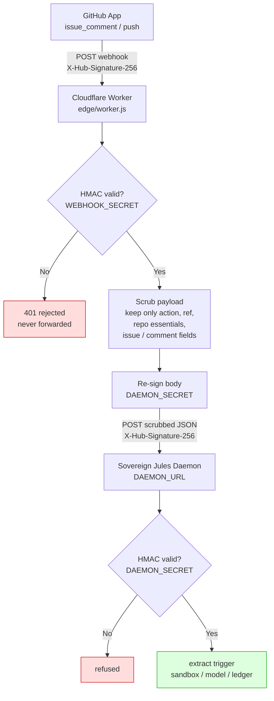

# Sovereign Jules

[](LICENSE)
[](https://www.rust-lang.org)
[](test/run-tests.sh)
[](STATUS.md)
[]()

A Jules-style asynchronous coding orchestrator on owned ground.

Google's Jules is proprietary, cloud-hosted, and now winding down. Its architecture is not. This is that architecture rebuilt sovereign: a GitHub webhook listener, an ephemeral sandbox per task, tool discovery instead of context stuffing, a local or API model, a test gate, and a pull request — every stage sealed in a hash-chained run ledger, watched from a zero-dependency dashboard in the Jules dark-mode aesthetic.

## The original Google Jules


Jules (Google Labs) launched in public beta on 19 May 2025 as an asynchronous coding agent that clones a repository into a cloud VM, understands the codebase, works autonomously on a task (bug fix, feature, tests, dependency bump), and opens a pull request. It exited beta in August 2025, powered by Gemini 2.5 Pro, with structured pricing tiers and deeper GitHub / CLI integration. The purple octopus mark and dark interface became its signature look.

On 29 October 2026 Google announced Jules would wind down. Existing sessions become read-only on 11 November 2026; the service shuts completely on 31 December 2026. Learnings are being folded into the Antigravity project. Users can export sessions, memories, environment snapshots, and related state before the cutoff.

## The mission

Keep the architecture alive on hardware the operator owns.

The product is proprietary and disappearing. The pattern — webhook trigger, ephemeral sandbox, model that emits full-file changes, test gate, sealed ledger, pull request — is not. Sovereign Jules reimplements that pattern with:

- zero external crates (Rust standard library only)
- tool discovery against a sealed registry instead of preloading every tool definition
- optional WebGPU / WebLLM backend (no Python, no CUDA, no external API)
- edge HMAC verification and payload scrubbing before the daemon ever sees the delivery
- an append-only, hash-chained run ledger that can be recomputed and refused if tampered
- a dashboard that renders the ledger in the original Jules Labs dark aesthetic (raw CSS, no framework)

The goal is not a clone of a cloud service. It is the same loop, under the operator's control, after the original is gone.

## Topics

`jules` `google-jules` `asynchronous-agent` `coding-agent` `sovereign` `rust` `webgpu` `webllm` `hash-chain` `tool-discovery` `mcp` `github-app` `ephemeral-sandbox`

## Webhook — how it works

GitHub never talks to the daemon directly. Deliveries hit `edge/worker.js` (Cloudflare Worker) first.



1. **Verify.** The worker checks the `X-Hub-Signature-256` HMAC-SHA256 against `WEBHOOK_SECRET`. A forged or missing signature is rejected with 401 at the edge and never forwarded.
2. **Scrub.** The payload is reduced to only the fields the daemon needs:
   - `action`, `ref`
   - `repository.full_name`, `clone_url`, `default_branch`
   - if present: `issue.number`, `issue.title`
   - if present: `comment.body`, `comment.user.login`
   Installation metadata, sender objects, URLs, and the rest of the GitHub tail are dropped on the edge, not inside the house.
3. **Forward.** The scrubbed JSON is re-signed with `DAEMON_SECRET` and POSTed to the daemon (`DAEMON_URL`). The daemon's own HMAC check therefore verifies exactly the body it receives.

The GitHub App is configured for `issue_comment` and `push` events. See `edge/wrangler.toml.example` for the Worker variables and secrets.

## Triggers

A task starts when an `issue_comment` delivery arrives whose body contains the configured bot mention (`@<bot_name>` from the config).

- The daemon extracts the repository, the branch (from the issue or default), and the prompt text that follows the mention.
- Comments that do not contain the trigger do nothing.
- A `push` event can also be used for other orchestration paths; the primary user-facing trigger is the mention in a comment.

The full extraction and sandbox hand-off is in the daemon; the edge only delivers the scrubbed, verified payload.

## The cognitive engine — WebGPU

Two model backends, one seam (`model_backend`):

- `http` — an OpenAI-shaped endpoint (local Ollama, an API).
- `webllm` — a headless Chromium page served by the daemon at `GET /infer` loads **WebLLM**, which runs the model through **WebGPU** directly in VRAM: no Python, no CUDA, no external API. The daemon hands the page jobs (`/infer/next`, `/infer/result`) carrying the repository context and the task text; the page returns the completion. The pipeline downstream — apply, test gate, push, PR — is identical either way.

## The loop

1. **Ingestion.** A GitHub App (Contents, Pull Requests, Issues: read/write; `issue_comment` and `push` events) points its webhook at the edge Worker. With secrets set, deliveries must carry a valid HMAC or they are refused.
2. **Trigger.** A comment mentioning `@<bot_name>` starts a task: the daemon extracts the repository, branch, and prompt.
3. **Sandbox.** The repository is cloned into an ephemeral work directory for this task alone.
4. **Discovery.** The task prompt is matched against the Tool Discovery Engine's sealed registry; the model receives the candidate tools for this task — not a preloaded catalogue.
5. **Model.** An OpenAI-shaped endpoint (local Ollama by default; the owner's 27B on the Jetson, or an API) returns full-file changes in `FILE:` blocks, which are applied to the clone. Unsafe paths are refused.
6. **Test gate.** The configured test command runs in the sandbox. Failure stops the line: no push, and the ledger says so.
7. **Pull request.** On a pass, the daemon pushes branch `sovereign/<task-id>` and opens a PR whose body is the standard checklist markdown (`- [x]`) with the terminal output in a fenced block. Without a GitHub token the run is a dry run: the payload is written to the run directory, never faked.

## The dashboard

`GET /` renders the run ledger as task cards in the Jules Labs dark aesthetic — raw CSS, no framework, no scripts. The ledger itself is append-only and hash-chained; `--verify-ledger` recomputes it.

## Configuration

See `sovereign-jules.conf.example` (key = value): port, bot name, workdir, model endpoint and name, discovery engine paths, test command, git identity, webhook secret, and the environment variable that holds the GitHub token. Tokens come from the environment only; they are never written to disk or to the ledger.

## Build and test

```sh
cargo build --release
./test/run-tests.sh
```

Zero external crates: the daemon is Rust standard library only. Verified: 18/18 tests, ledger chain recomputes, edge worker scrubs and re-signs, WebGPU interop channel completes the full loop under a stand-in client.

## Status

See [STATUS.md](STATUS.md) for verified claims and known limits (live GitHub App loop requires the owner's token and edge route; WebGPU inference requires a GPU machine).

## License

[SnapKitty Opaque Source License](LICENSE) — research, study, internal evaluation, security analysis, and formal verification permitted. Commercial exploitation requires separate written authorization from the Licensor.

---

**SnapKitty Research Lab** · Bel esprit D'accord Trust

The architecture that Google is shutting down continues here, on owned ground.
